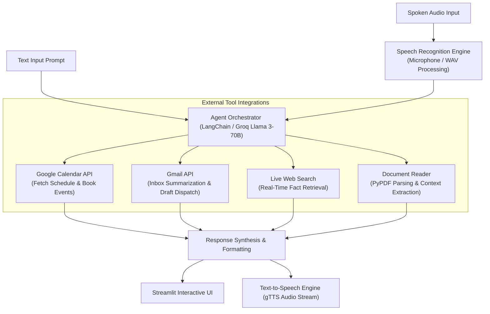

# Voice-Enabled Executive Assistant
### Multimodal Task Automation, Tool Augmentation & Context-Aware Execution

[](https://www.python.org/)
[](https://streamlit.io/)
[](https://langchain.com/)
[](https://groq.com/)
[](https://developers.google.com/)
[](LICENSE)

---

## Overview

Executive assistants require integrating conversational speech comprehension with tool calling across disparate productivity suites. This repository implements a voice-enabled multimodal AI executive assistant capable of transcribing spoken natural language, routing queries to external API tool chains, synthesizing responses, and reading summaries aloud.

Powered by **LangChain** and **Groq Llama 3-70B**, the assistant bridges real-time tool augmentation across calendar scheduling, email composition, live web search, and document summarization.

---

## Tool-Augmented Architecture



---

## Core Capabilities

* **Voice & Text Modalities:** Dual-input interface allowing hands-free verbal interaction or typed keyboard prompts with low-latency audio synthesis via gTTS.
* **Autonomous Calendar Management:** Queries scheduled meetings, identifies schedule conflicts, and structures new event payloads through OAuth-authenticated Google Calendar endpoints.
* **Email Intelligence & Drafting:** Authenticates with Gmail API to retrieve unread threads, produce concise priority summaries, and generate human-in-the-loop email drafts.
* **Ad-Hoc Document Ingestion:** Parses uploaded PDF agreements and reports, passing extracted context to the model for question-answering.
* **Low-Latency Generation:** Utilizes Groq LPUs running Llama 3-70B to produce conversational answers at near-instantaneous token generation rates.

---

## Setup & Installation

### Prerequisites
* Python 3.10+
* Google Cloud project with Gmail and Calendar APIs enabled (`credentials.json`)
* Groq Cloud API Key

### 1. Clone the Repository
```bash
git clone https://github.com/ahmadarif238/ai-executive-agent.git
cd ai-executive-agent
```

### 2. Environment Setup
```bash
python -m venv venv

# Windows
venv\Scripts\activate
# Linux/macOS
source venv/bin/activate

pip install -r requirements.txt
```

### 3. API Key & OAuth Configuration
Create a `.env` file in the project root:
```env
GROQ_API_KEY=your_groq_api_key_here
```
Place your downloaded Google Cloud OAuth client file `credentials.json` in the root directory to authorize Calendar and Gmail tool access.

### 4. Run Application
```bash
streamlit run streamlit_app.py
```
Open `http://localhost:8501` to access the assistant.

---

## Author & Academic Context

Engineered by **Arif Ahmad Khan** as an implementation of tool-augmented conversational agents and speech-driven multimodal productivity workflows.

Released under the [MIT License](LICENSE).
